# Listly

[English](README.md) · [Español](README.es.md) · [Català](README.ca.md) · [Galego](README.gl.md) · [Euskara](README.eu.md) · [Français](README.fr.md) · [Deutsch](README.de.md) · [Português](README.pt.md)

**Listly** è un gestore di liste local-first per l'uso quotidiano. Crea tutte le liste che ti servono — spesa, attività, bagaglio, dispensa — organizzale in raccolte e spunta gli elementi man mano che procedi. Le liste possono essere semplici liste di controllo o liste numeriche che registrano un importo e una quantità per elemento con un totale progressivo.

Tutto funziona **sul dispositivo**: i tuoi dati vivono in un database SQLite locale (sql.js + IndexedDB sul web), nulla lascia il tuo telefono e non sono richiesti account né abbonamenti.

| | |
|---|---|
| **Piattaforme** | iOS, Android e Web |
| **Versione** | 1.1.0 |
| **Lingue** | Inglese, Spagnolo, Catalano, Galiziano, Basco, Francese, Tedesco, Portoghese, Italiano |
| **Dati** | 100 % locali (SQLite su nativo, sql.js + IndexedDB sul web) |
| **Temi** | Scuro, Chiaro e Automatico (segue il sistema) |

## Funzionalità

- **Liste** — crea tutte le liste che vuoi, ciascuna con la propria icona e il proprio colore, e scegli tra due tipi di lista: **Standard** (lista di controllo) o **Numerica**, con un importo e una quantità per elemento.
- **Elementi** — aggiungi elementi rapidamente dalla barra inferiore, spuntali e apri un elemento per aggiungere una **nota** o una **foto** (galleria su tutte le piattaforme, fotocamera su iOS e Android).
- **Liste numeriche** — assegna a ogni elemento un importo e una quantità; l'intestazione della lista mostra una **barra di avanzamento per valore** (sempre visibile, ad es. `3.20 / 22.17 · 14.43 %`) e ogni elemento mostra il proprio totale di riga (importo × quantità). Toccando l'importo di un elemento quando è vuoto o a `0.00` il campo si svuota, così puoi digitare subito un prezzo.
- **Raccolte** — raggruppa le liste in raccolte (cartelle) come *Casa* o *Lavoro*, e trascina una lista su una raccolta per spostarla dentro.
- **Trascina e rilascia** — riordina liste ed elementi con pressione prolungata e trascinamento; salvato tramite una colonna `position`.
- **Liste bloccate** — proteggi una lista con una passphrase; i suoi elementi vengono cifrati **sul dispositivo** con AES-256-GCM. Se dimentichi la passphrase, non c'è recupero.
- **Duplica, copia e unisci** — duplica un'intera lista, copia una lista con o senza le sue note, copia gli elementi selezionati in un'altra lista, oppure unisci elementi in un'altra lista. Copiando una lista numerica vengono inclusi anche importo × quantità = totale di ogni elemento e le somme Totale/Fatto.
- **Ordinamento** — ordina una lista manualmente, per nome o per il momento in cui è stato aggiunto ogni elemento, in modo crescente o decrescente.
- **Modalità selezione** — entra in modalità selezione dall'intestazione per selezionare più elementi ed eliminarli (o selezionare più liste insieme) in un colpo solo.
- **Ricerca** — filtra liste ed elementi dalla ricerca dell'intestazione su Home, Liste e all'interno di una lista.
- **Impostazioni** — tema, dimensione del testo, lingua, layout per schermata (griglia o righe) e campi opzionali per tipo di lista (note e foto nella vista dell'elemento e nella schermata di modifica).
- **Backup** — esporta l'intero database come file JSON e reimportalo quando vuoi, con azioni protette di eliminazione totale e ripristino di fabbrica.

## Screenshot

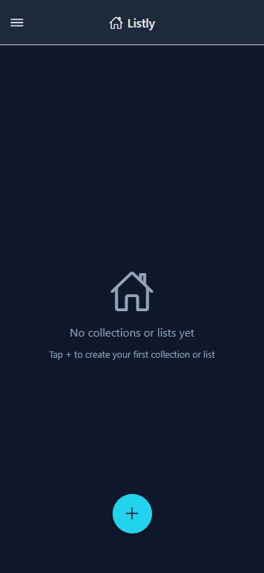<br>*La schermata Home prima che esista qualsiasi raccolta o lista.*<br><br>
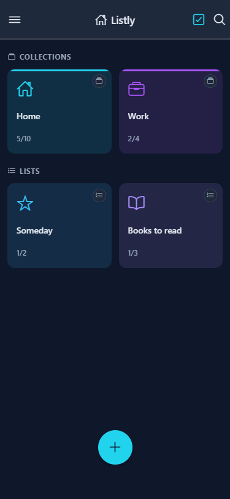<br>*Home con due raccolte e liste indipendenti, con il progresso di ogni raccolta.*<br><br>
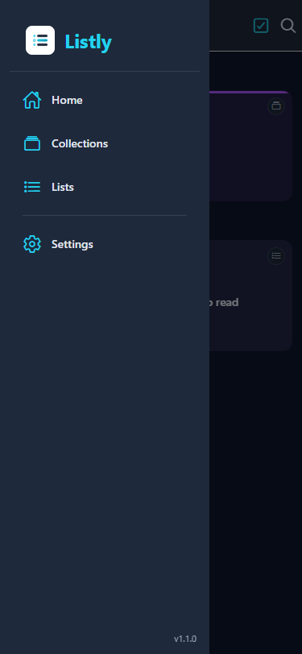<br>*Menu laterale con Home, Raccolte, Liste e Impostazioni — e la versione dell'app in basso.*<br><br>
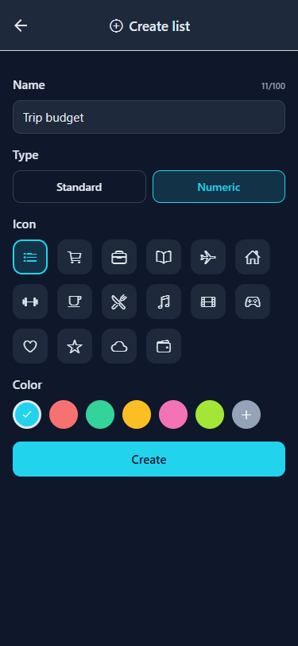<br>*Crea una lista: nome, tipo (Standard o Numerica), icona e colore.*<br><br>
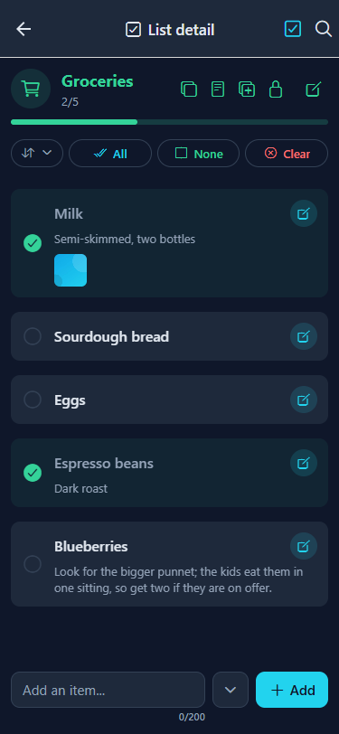<br>*Una lista standard con elementi spuntati, note, una foto, il controllo di ordinamento e le azioni in blocco — l'intestazione resta fissa durante lo scorrimento.*<br><br>
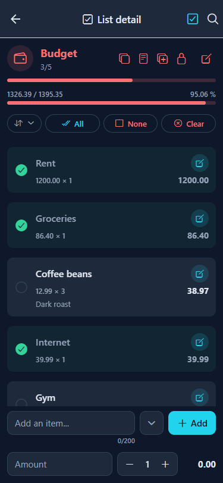<br>*Una lista numerica con una barra di avanzamento per valore, i totali di riga e la riga importo/quantità.*<br><br>
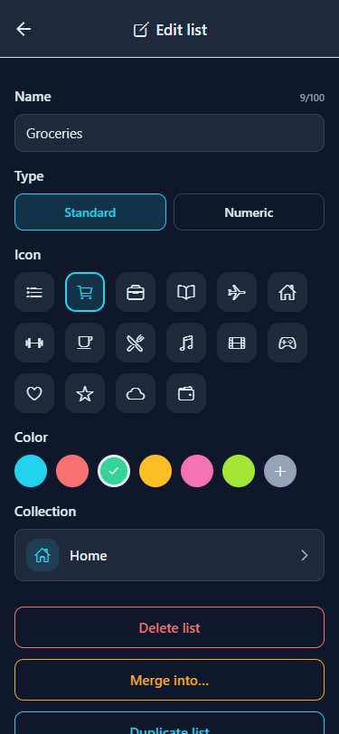<br>*La schermata Modifica lista: rinominare, cambiare tipo, icona e colore, spostare la lista in una raccolta e Duplicare, Unire o Eliminare la lista.*<br><br>
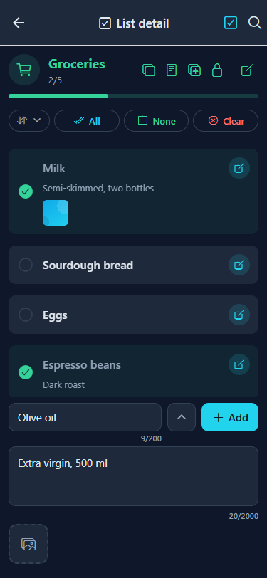<br>*La barra di aggiunta espansa per allegare una nota e foto al nuovo elemento.*<br><br>
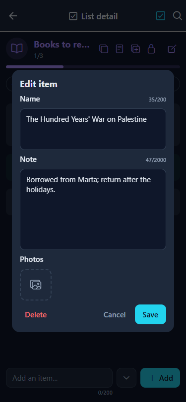<br>*Modifica di un elemento: nome su due righe, nota e foto.*<br><br>
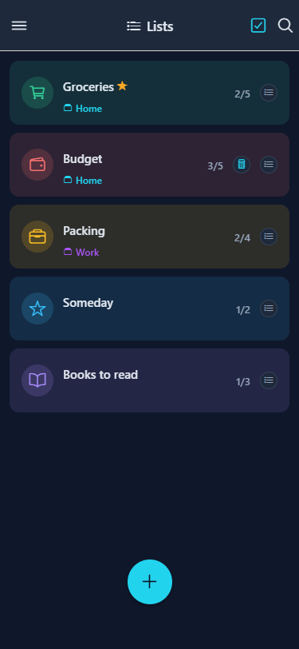<br>*La schermata Liste, con l'appartenenza alle raccolte e il progresso per lista.*<br><br>
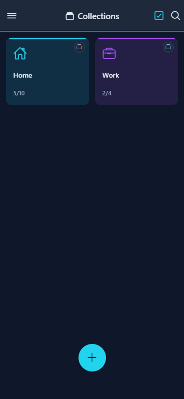<br>*La schermata Raccolte.*<br><br>
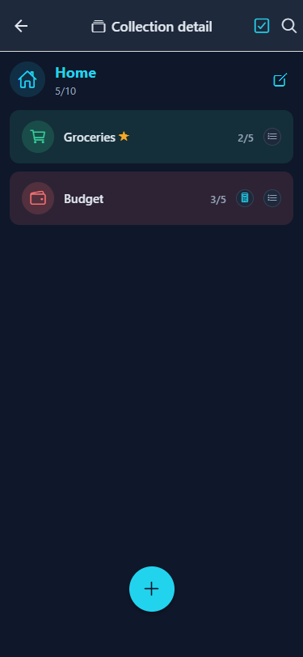<br>*Una raccolta con le sue liste membro.*<br><br>
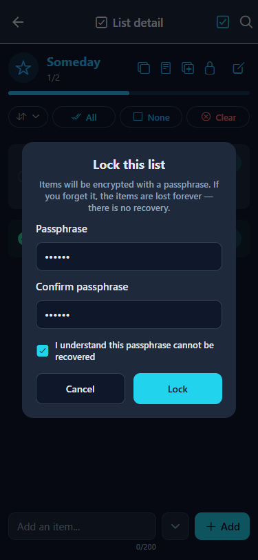<br>*Bloccare una lista con una passphrase.*<br><br>
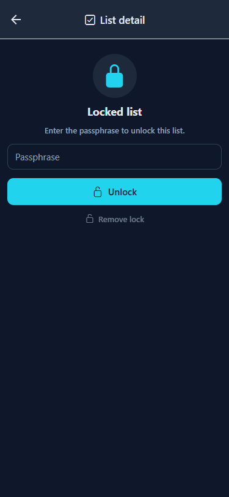<br>*Una lista bloccata, in attesa della passphrase.*<br><br>
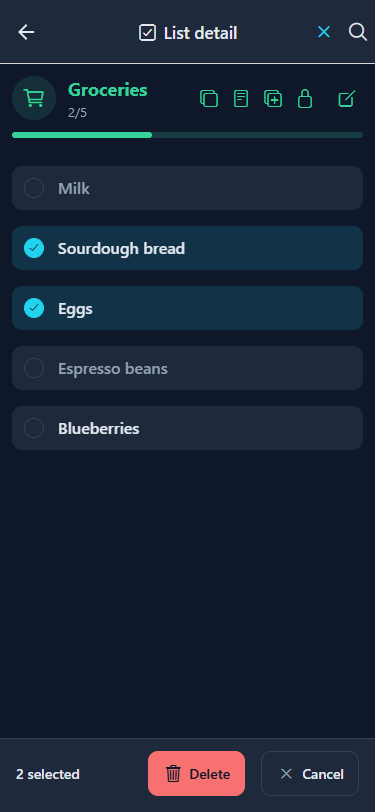<br>*Modalità selezione con la barra delle azioni inferiore.*<br><br>
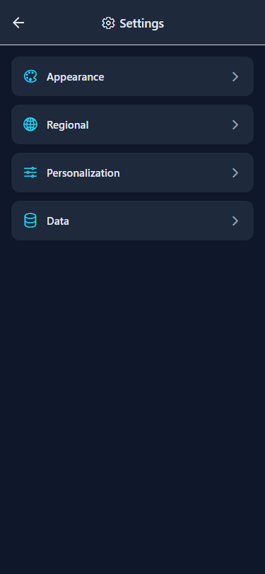<br>*Impostazioni: Aspetto, Regionale, Personalizzazione e Dati.*<br><br>
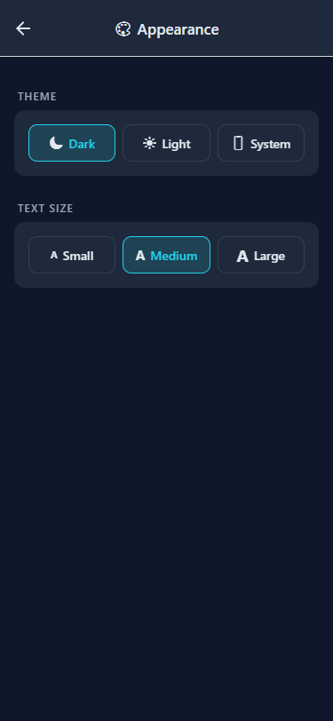<br>*Aspetto: tema e dimensione del testo.*<br><br>
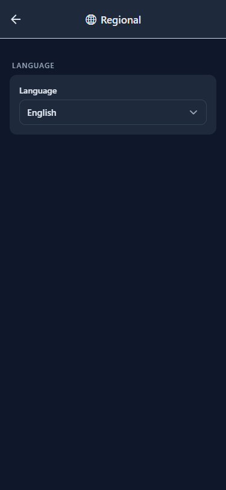<br>*Impostazioni regionali: lingua.*<br><br>
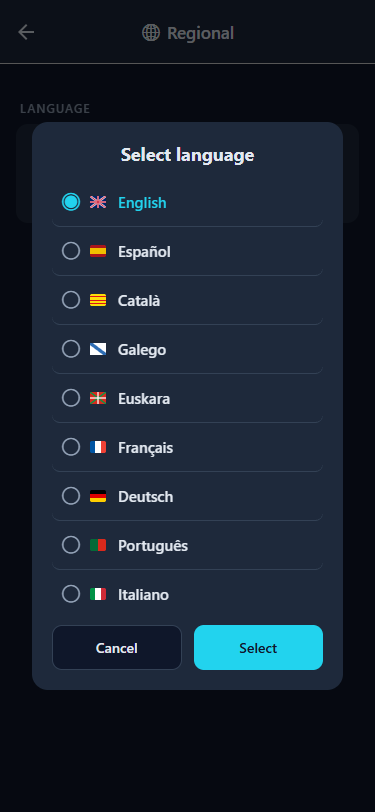<br>*Il selettore della lingua con le nove lingue e le loro bandiere.*<br><br>
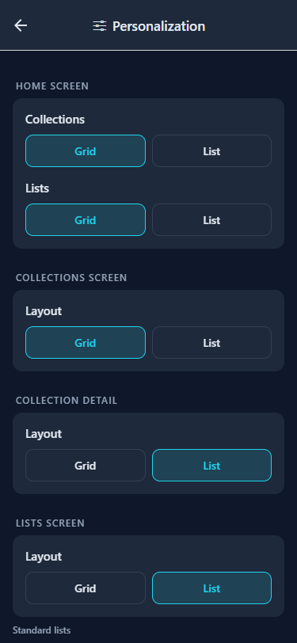<br>*Personalizzazione: layout per schermata e campi opzionali per tipo di lista.*<br><br>
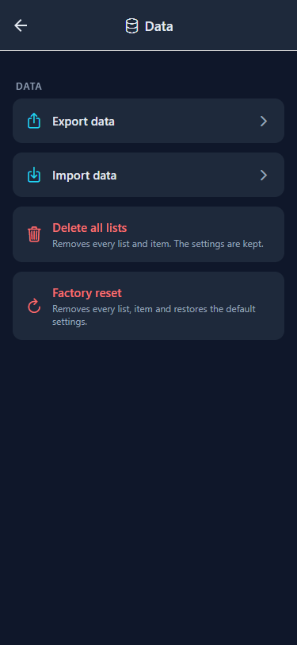<br>*Dati: esporta/importa e le azioni protette di eliminazione e ripristino.*<br><br>

## Tecnologie

| Livello | Tecnologia |
|---|---|
| Framework | React Native con Expo (SDK 57) |
| Linguaggio | TypeScript |
| Navigazione | React Navigation (Stack + Drawer) |
| Icone | @expo/vector-icons (Ionicons) |
| Trascina e rilascia | react-native-sortables |
| Selettore colore | reanimated-color-picker |
| Cifratura | quick-crypto (AES-256-GCM per le liste bloccate) |
| Persistenza | SQLite (expo-sqlite) su nativo, sql.js (WASM) + IndexedDB sul web |
| ORM | Drizzle ORM (query builder su un `DatabaseHandle` condiviso) |
| Validazione | Schemi Zod come unica fonte di verità per le righe memorizzate |
| Web | react-native-web |
| Stato | Context API (AppContext + ConfigContext) |
| i18n | Sistema proprietario (en, es, ca, gl, eu, fr, de, pt, it) |

## Sviluppo

Questa sezione è per i contributori e per chiunque voglia eseguire, fare fork o estendere l'app.

### Requisiti

- Node.js 20+ (Node 24 consigliato)
- npm
- Un emulatore Android opzionale (la cartella `android/` è generata da CNG — vedi sotto)

### La prima volta dopo il clone

```bash
cd ListlyApp
npm install
npx expo start
```

Questo avvia Metro Bundler. Poi:

| Per vederlo su… | Fai questo |
|---|---|
| **Browser** | Apri http://localhost:8081 o esegui `npx expo start --web` |
| **Android (emulatore)** | Esegui `npx expo run:android` |
| **iOS (simulatore)** | Esegui `npx expo run:ios` (solo macOS) |

> Nota: le liste bloccate e il foglio di condivisione dipendono da moduli nativi, quindi usa una build di sviluppo o di release invece di Expo Go.

### Comandi

| Comando | Descrizione |
|---|---|
| `npm start` | Avvia Expo in modalità sviluppo |
| `npm run web` | Avvia e apre nel browser |
| `npm run android` | Avvia sull'emulatore Android |
| `npm run ios` | Avvia sul simulatore iOS (solo macOS) |
| `npm run typecheck` | Controllo TypeScript (`tsc --noEmit`) |
| `npm run lint` | ESLint tramite `expo lint` |
| `npm test` | Esegue la suite Vitest |
| `npm run test:watch` | Esegue Vitest in modalità watch |
| `npm run test:all` | typecheck + lint + tests (il gate locale completo) |

### Test

- **Unit / integrazione** — Vitest. La suite copre i repository del database su entrambi i backend SQLite (nativo + sql.js), i cicli di backup, la cifratura e i componenti renderizzati con `@testing-library/react-native`.
- **Verifica web** — i criteri di accettazione di ogni funzionalità vengono verificati in un browser reale a 375px con Playwright.
- La pipeline CI esegue il gate completo `npm run test:all` a ogni push e pull request verso `develop` e `main`.

> **Gate locale:** una modifica è conclusa solo quando `npm run test:all` passa.

### Struttura del progetto

```
ListlyApp/
  src/
    components/    — componenti UI riutilizzabili
    constants/     — temi, tipi, colori, icone
    context/       — AppContext, ConfigContext (stato globale)
    database/      — engine SQLite/sql.js, repository, migrazioni, schema Drizzle
    hooks/         — hook proprietari
    i18n/          — traduzioni (en, es, ca, gl, eu, fr, de, pt, it)
    navigation/    — AppNavigator (Drawer + Stack)
    screens/       — componenti schermata (PascalCase)
    utils/         — formattatori, piattaforma, lingua
```

### Database

- Un'unica interfaccia engine (`DatabaseHandle`) su tutte le piattaforme: expo-sqlite su nativo, sql.js (WASM) con persistenza IndexedDB sul web.
- Lo schema è creato da un `createSchema` canonico ed è versionato con `PRAGMA user_version`; le migrazioni vengono eseguite una volta, dentro una transazione.
- I repository sono scritti con il query builder di Drizzle sull'handle condiviso; le righe memorizzate sono validate con schemi Zod.
- Sul web i byte SQLite esportati vengono persistiti in IndexedDB, quindi gli stessi dati sopravvivono ai ricaricamenti.

### Generare un APK / AAB Android (EAS Build)

**Listly** usa EAS Build, che gestisce la chiave di firma Android così le versioni successive condividono la stessa firma e si aggiornano sul posto. Richiede un account Expo e la CLI di EAS:

```bash
npm install -g eas-cli
eas login
cd ListlyApp
```

| Profilo | Comando | Output |
|---|---|---|
| Development | `eas build --profile development` | build dev-client (interno) |
| Preview | `eas build --platform android --profile preview` | APK installabile (interno) |
| Production | `eas build --platform android --profile production --no-wait` | AAB pubblicabile (store) |

Il profilo `production` in `eas.json` usa `"distribution": "store"` e `"buildType": "app-bundle"`, producendo un AAB per l'invio allo store. `cli.appVersionSource` è `"local"`, quindi i metadati di versione sono letti direttamente da `app.json` — **incrementa `android.versionCode` (intero, strettamente crescente) e `ios.buildNumber` a ogni versione**. EAS genera e conserva la chiave di firma di release al primo build di produzione; fai un backup con `eas credentials` e non committarla mai (le chiavi sono nel .gitignore).

Per un rapido test locale puoi comunque compilare un APK firmato in debug dalla cartella nativa generata (usa una chiave di firma diversa, di debug — non per la distribuzione):

```bash
cd ListlyApp
npx expo prebuild --platform android   # rigenera il progetto nativo dopo modifiche di assets/config
cd android
./gradlew assembleRelease   # APK → app/build/outputs/apk/release/app-release.apk
```

### Metodologia

Questo progetto usa il **Specification-Driven Development (SDD).** Le specifiche vivono in `spec/` e sono l'unica fonte di verità — cosa costruire viene definito prima nei documenti `1-spec.md`, poi implementato e infine verificato rispetto ai criteri di accettazione. La roadmap è tracciata in `spec/constitution/3-roadmap.md`.

## Licenza

Listly è distribuito con licenza MIT — vedi il file [LICENSE](LICENSE).
